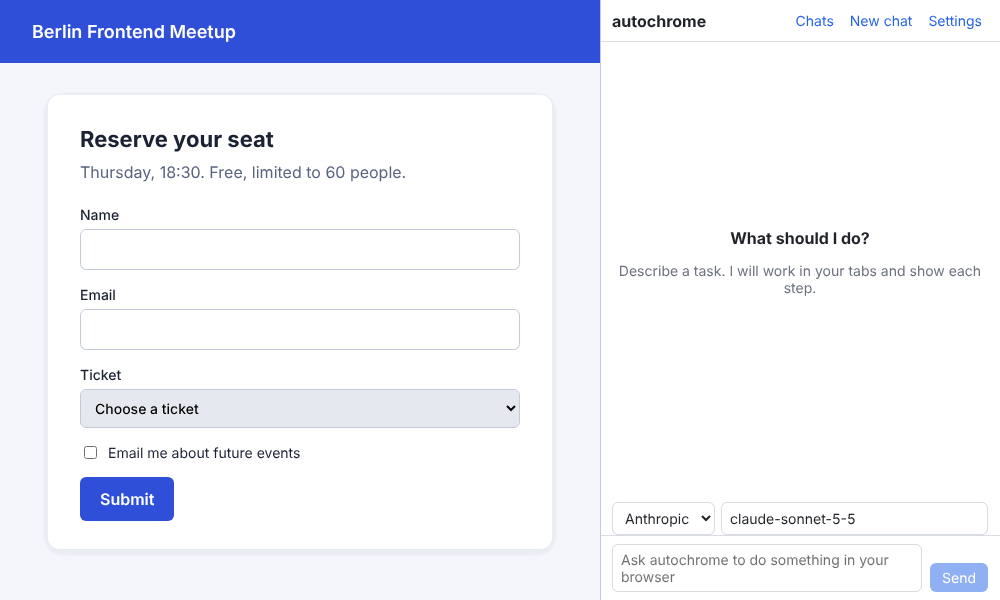

# autochrome

An open-source Chrome extension that lets an AI control your real browser, from a side panel chat or from outside tools like Claude Code and Cursor.



_The demo is recorded by a script (`pnpm demo`) with a scripted model on a local test page. It shows the real extension UI, not a real model._

## What it does

- **Side panel agent.** Describe a task and the agent works in your tabs, showing every step. Providers: Anthropic (Claude), OpenAI, Gemini, and any OpenAI-compatible server (Ollama, LM Studio, OpenRouter). Switch provider and model per chat.
- **Bridge.** `autochrome-bridge` is an MCP server (stdio) plus a local HTTP/WebSocket API, so Claude Code, Cursor or your own scripts can drive the same browser with the same tools.
- **Safety modes.** Ask every action, per-site approval (default) or auto. Risky actions always ask.
- **Debug tools.** Read the console, list network requests and their responses, run JavaScript in a page (always asks first).

The agent works on your real tabs and sessions, in its own colored tab group. Pages are read as a compact accessibility tree with short element IDs; screenshots and x/y clicks are the fallback.

## Status

Version 1.0.0. Everything is covered by unit tests and Playwright end-to-end tests that run the built extension in Chromium against **local mock provider servers**. The bridge was also verified with the real Claude Code CLI (over MCP) driving headless Chromium.

**Not yet tested against the real provider APIs** (Anthropic, OpenAI, Gemini, Ollama, LM Studio, OpenRouter). The request and response handling was written from each provider's API reference (for OpenAI and Gemini, via documentation excerpts and the official SDK type definitions), so expect rough edges on the first real run and please [open an issue](https://github.com/FahadDhruba/autochrome/issues) if you hit one. Chrome is the target browser; Edge and Brave should work but are untested.

## Install the extension

Requires Node 22+ and [pnpm](https://pnpm.io) 10.

**From source**

```sh
git clone https://github.com/FahadDhruba/autochrome.git
cd autochrome
pnpm install
pnpm build
```

Open `chrome://extensions`, turn on Developer mode, click **Load unpacked** and choose `packages/extension/.output/chrome-mv3`.

**From a release zip** (once a release exists)

Download `autochrome-<version>-chrome.zip` from the [Releases page](https://github.com/FahadDhruba/autochrome/releases) and unzip it. Then **Load unpacked** on the unzipped folder, as above. It is not on the Chrome Web Store.

Chrome shows a "started debugging this browser" banner while the agent works. That is expected: input and debugging tools use `chrome.debugger`.

## Use the side panel

1. Click the autochrome toolbar icon to open the side panel.
2. Open **Settings**, pick a provider and paste its API key. For OpenAI, enter a model name. For Ollama, LM Studio or OpenRouter choose the OpenAI-compatible provider and set its base URL (for example `http://localhost:11434/v1`).
3. Back in the chat, give it a task. Use **Stop** to cancel at any time.

API keys are stored in `chrome.storage.local` in your browser profile. They are sent only to the provider you configured, and never to the bridge. Chat history is stored locally too.

## Workflows

A workflow is a list of steps you can replay without the AI.

- **Record** in the **Workflows** view, do the task yourself, then press **Stop**. Clicks, typed values, selects, checkboxes and Enter become steps. A password field becomes a `{{password}}` variable; the value you typed never leaves the page.
- **Save as workflow** appears under a finished chat. Its successful actions become steps; reads such as `read_page` are dropped.
- **Edit** a workflow to rename it, reorder or delete steps, change values, and select text in a value and press **Make variable** to ask for it on each run. **Export** and **Import** share workflows as JSON.
- **Run** asks for the variables, opens a tab of its own and replays the steps. Each step finds its element again by role and name, then visible text, then CSS selector. If a step fails, the AI (your default provider) gets up to 8 tool calls to do just that step, and the run log offers **Update workflow with repaired step**. With no provider set up, the run stops at that step with a clear message and a screenshot.

A replay goes through the same permission checks as the agent. The bridge exposes `workflows_list` and `workflow_run`, so Claude Code can run your workflows.

## Use from Claude Code, Cursor or scripts

The bridge runs on your machine and only listens on `127.0.0.1`.

1. Get the pairing token: `npx -y autochrome-bridge token`
2. Paste it in the side panel under **Settings → Bridge**. The status dot turns green when connected.
3. Add it to your MCP client.

Claude Code:

```sh
claude mcp add autochrome -- npx -y autochrome-bridge
```

Cursor (`~/.cursor/mcp.json`):

```json
{
  "mcpServers": {
    "autochrome": { "command": "npx", "args": ["-y", "autochrome-bridge"] }
  }
}
```

Scripts (HTTP API; start the hub with `npx -y autochrome-bridge serve`):

```sh
TOKEN=$(npx -y autochrome-bridge token)
curl -X POST -H "Authorization: Bearer $TOKEN" \
  -d '{"url":"https://example.com"}' http://127.0.0.1:47800/v1/tools/tab_open
```

Bridge calls pass through the same safety checks as the side panel, so approvals appear in Chrome (in the side panel, or in a small popup window if it is closed). Details, the WebSocket API and options are in [packages/bridge/README.md](packages/bridge/README.md).

> `autochrome-bridge` is published to npm automatically with each release. If `npx` cannot find it yet, run it from a checkout: `node packages/bridge/dist/cli.js` after `pnpm build`.

## Safety

You choose a mode in Settings → Safety:

| Mode               | Behaviour                                                                          |
| ------------------ | ---------------------------------------------------------------------------------- |
| Ask every action   | Every action asks first. Reading a site you have not allowed also asks.            |
| Per-site (default) | Approve a site once with Allow on this site. Risky actions still ask every time.   |
| Auto               | No prompts. The side panel shows an "Auto" badge. Only use it for tasks you trust. |

What counts as risky: clicking or pressing Enter on buttons or links that purchase or pay (buy, checkout, place order, donate), send or publish (send, post, submit, reply), or delete (delete, remove, close account); and typing into password or card fields. In auto mode these do not ask either.

Always on:

- `js_eval` asks before every run, in every mode, including auto.
- Page text is wrapped as untrusted data and the system prompt tells the model never to follow instructions found in it.
- `chrome://`, extension and Chrome Web Store pages are refused.
- The bridge accepts only local connections with the pairing token and rejects requests that carry a browser `Origin` header.
- A prompt with no answer after 2 minutes counts as a denial.

Limits: prompt injection cannot be fully prevented. A malicious page can still try to talk the model into harmful but non-obvious actions, and keyword-based risk detection will miss some. Read what an approval prompt says before you click Allow, be careful in auto mode, and avoid running the agent on pages you do not trust while signed in to sensitive accounts. See [SECURITY.md](SECURITY.md).

## Tools

The side panel agent and bridge clients use the same tools. This table is generated from the tool definitions in `packages/shared` by `pnpm docs:tools`; CI fails if it is out of date.

<!-- tools:start (generated by `pnpm docs:tools`, do not edit) -->

| Tool               | What it does                                                                                                                                         |
| ------------------ | ---------------------------------------------------------------------------------------------------------------------------------------------------- |
| `tabs_list`        | List open tabs, one per line as "tabId · title · url".                                                                                               |
| `tab_open`         | Open a new tab in the agent tab group and make it the current tab, unless background is true.                                                        |
| `tab_switch`       | Make an existing tab the current tab, bring it to the front and add it to the agent tab group.                                                       |
| `tab_close`        | Close a tab.                                                                                                                                         |
| `navigate`         | Load a URL in a tab and wait for it to finish loading.                                                                                               |
| `go_back`          | Go back one step in the tab history and wait for the page to load.                                                                                   |
| `go_forward`       | Go forward one step in the tab history and wait for the page to load.                                                                                |
| `read_page`        | Read the page as a compact accessibility tree.                                                                                                       |
| `find`             | Find elements whose role, name or value contains the query (case-insensitive).                                                                       |
| `get_text`         | Get the page title, URL and readable text (up to 20,000 characters).                                                                                 |
| `screenshot`       | Take a JPEG screenshot of the visible viewport.                                                                                                      |
| `click`            | Click an element by ref, or a viewport point by x and y.                                                                                             |
| `type`             | Type text into the focused element, or into the element given by ref (focused first).                                                                |
| `key`              | Press a key or key combination.                                                                                                                      |
| `scroll`           | Scroll the page, or the element under the given ref or x/y point.                                                                                    |
| `form_input`       | Set the value of an input, textarea, select, checkbox or radio by ref and fire input and change events.                                              |
| `wait`             | Wait for a fixed time, for text to appear in the page, or both.                                                                                      |
| `console_logs`     | Read the browser console of a tab: console.* calls, uncaught exceptions and browser warnings, newest last.                                           |
| `network_requests` | List the network requests a tab made, one per line as "[requestId] METHOD status url (type, size, ms)".                                              |
| `network_response` | Get the response headers and body of a request listed by network_requests.                                                                           |
| `workflows_list`   | List the saved workflows (recorded in the browser or saved from a chat) with their ids, names and variables.                                         |
| `workflow_run`     | Replay a saved workflow by id or name in its own tab and return the run log: each step with its status (ok, repaired by AI, or failed) and duration. |
| `js_eval`          | Run JavaScript in the page and return the JSON result (or the exception).                                                                            |

<!-- tools:end -->

## Development

```
┌──────────── Chrome extension (MV3) ────────────┐
│ Side panel (React)  ←→  Background worker      │
│   chat, settings        agent loop, providers, │
│                         tool executor, safety  │
│                    ↕ chrome.debugger / scripts │
│                    Your real tabs              │
└────────────────────────↕───────────────────────┘
                  WebSocket (localhost + pairing token)
┌────────────── Bridge (Node, separate) ─────────┐
│  MCP server (stdio)  →  Claude Code, Cursor…   │
│  WebSocket/HTTP API  →  your own scripts       │
└────────────────────────────────────────────────┘
```

| Path                 | Contents                                                             |
| -------------------- | -------------------------------------------------------------------- |
| `packages/shared`    | Tool definitions and message protocol types                          |
| `packages/extension` | WXT + React extension: side panel, background worker, content script |
| `packages/bridge`    | Node MCP server and HTTP/WebSocket API (`autochrome-bridge`)         |
| `scripts`            | Maintainer scripts: tools table, icons, demo GIF                     |
| `docs/plans`         | The design spec for each milestone                                   |

Common commands: `pnpm dev`, `pnpm build`, `pnpm lint`, `pnpm typecheck`, `pnpm test`, `pnpm test:e2e` (build first). See [CONTRIBUTING.md](CONTRIBUTING.md) for setup, tests and how to add a tool or provider, and [PLAN.md](PLAN.md) for the design.

## License

[MIT](LICENSE) © fahaddhruba
