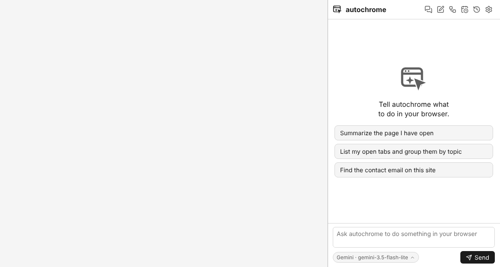
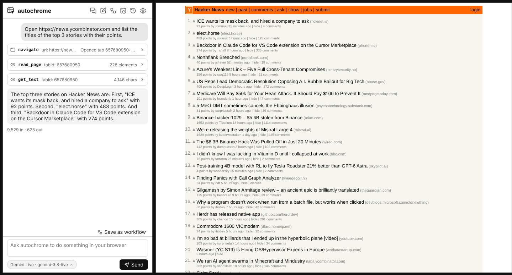
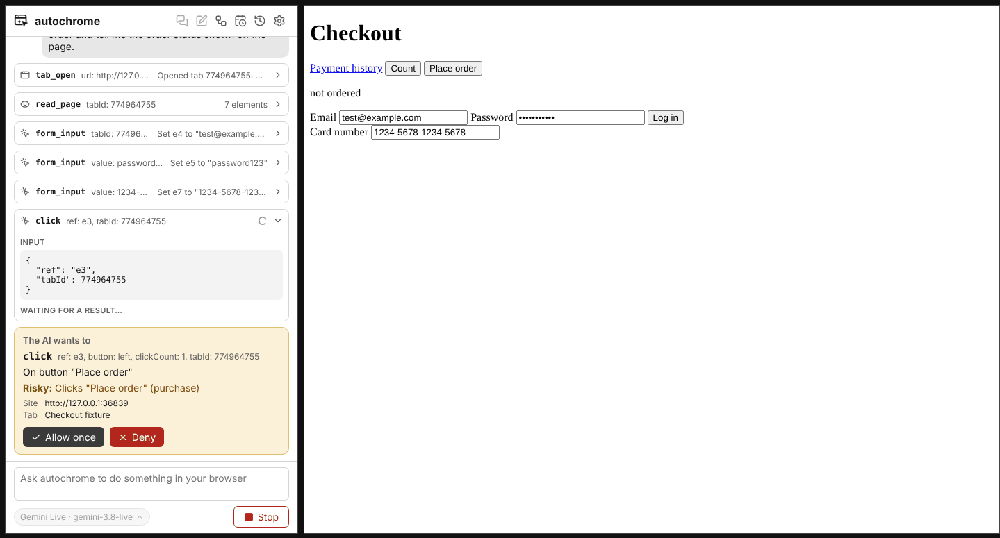

<p align="center"></p>

# autochrome

An open-source Chrome extension that lets an AI use your real browser. Tell it what to do in a side panel chat, and it clicks, types and reads pages in your tabs while you watch. Tools like Claude Code and Cursor can drive it too.



_A real, unedited run with Gemini (`gemini-3.5-flash-lite`) on wikipedia.org: the task took 28 seconds, shown at 2× speed. Approval prompts were answered by the recording script._

**Contents:** [Get started](#get-started) · [Using autochrome](#using-autochrome) · [Safety](#safety) · [Workflows](#workflows) · [Schedules](#schedules) · [Claude Code and Cursor](#use-from-claude-code-or-cursor) · [Troubleshooting](#troubleshooting) · [For developers](#for-developers)

## What it does

- **An AI agent in a side panel.** Describe a task ("fill in this form", "find the cheapest flight on this page", "summarize my open tabs") and watch it work, step by step.
- **Your choice of AI.** Claude (Anthropic), OpenAI, Gemini, Gemini Live, or a model on your own computer (Ollama, LM Studio) or through OpenRouter. Switch per chat.
- **You stay in control.** By default it asks before acting on a new site, and always asks before buying, sending, deleting or typing a password or card number.
- **Workflows and schedules.** Record a task once and replay it without the AI, or run it on a timer.
- **Works with Claude Code and Cursor**, which can use the same browser through the `autochrome-bridge` add-on.

The agent works in your real tabs, signed in as you, inside its own colored tab group so you can see which tabs it is using.

# Get started

You need Google Chrome and an API key from an AI provider. No coding or extra software is needed.

## 1. Install the extension

autochrome is not on the Chrome Web Store yet, so you add it yourself:

1. Download the latest `autochrome-<version>-chrome.zip` from the [Releases page](https://github.com/FahadDhruba/autochrome/releases/latest).
2. Unzip it into a folder you will keep, for example `Documents/autochrome`. Chrome loads the extension from this folder, so do not delete or move it.
3. Open `chrome://extensions` in Chrome.
4. Turn on **Developer mode** (top right).
5. Click **Load unpacked** and choose the unzipped folder.
6. Click the puzzle-piece icon in the toolbar and pin **autochrome**, so its icon stays visible.

## 2. Get an API key

The AI runs at a provider you choose, with your own key. Pick one:

| Provider                 | Where to get a key                                                                             | Notes                                                                                        |
| ------------------------ | ---------------------------------------------------------------------------------------------- | -------------------------------------------------------------------------------------------- |
| **Gemini** (recommended) | [Google AI Studio](https://aistudio.google.com/apikey)                                         | Free tier available. Tested with real tasks.                                                 |
| Gemini Live              | Same key as Gemini                                                                             | For Live-only models such as `gemini-3.8-live`. Slower, see below.                           |
| Claude (Anthropic)       | [Anthropic Console](https://console.anthropic.com/settings/keys)                               | Paid.                                                                                        |
| OpenAI                   | [OpenAI Platform](https://platform.openai.com/api-keys)                                        | Paid.                                                                                        |
| Ollama or LM Studio      | No key; runs on your computer ([Ollama](https://ollama.com), [LM Studio](https://lmstudio.ai)) | Free. Use the OpenAI-compatible provider with base URL `http://localhost:11434/v1` (Ollama). |
| OpenRouter               | [OpenRouter](https://openrouter.ai/keys)                                                       | Many models behind one key. Use the OpenAI-compatible provider.                              |

## 3. Set it up

1. Click the autochrome icon in the toolbar. The side panel opens on the right.
2. Click **Settings** (gear icon). Every icon shows its name when you hover over it.
3. Choose your provider, paste the API key and pick a model.

Your key is stored only in this Chrome profile and is sent only to the provider you chose.

## 4. Give it a task

Type what you want in the box at the bottom and press **Send**. For example:

- "Open wikipedia.org and tell me when Ada Lovelace was born."
- "Fill in this form with my name, Ada Lovelace, and ada@example.com, then submit it."
- "List my open tabs and group them by topic."
- "On this page, find the contact email."

Each step appears as a card in the chat; click a card to see exactly what was sent and what came back. Press **Stop** at any time. When it needs permission, an approval card appears: read it, then choose **Allow once**, **Allow on this site** or **Deny**.

While the agent works, Chrome shows a bar saying autochrome "started debugging this browser". That is normal: it is how the extension clicks and types for you.

# Using autochrome

## Chats and models

- **New chat** starts over. **Chats** lists your earlier chats; they are saved in this browser only.
- The chip under the message box (for example `Gemini · gemini-3.5-flash-lite`) switches provider and model for the current chat.
- **Save as workflow** under a finished chat turns what the AI did into a replayable [workflow](#workflows).

**Gemini Live** (`gemini-3.8-live` and similar) can only answer by voice, so autochrome shows the transcript of the spoken reply. It works for real tasks but is slower: about 1 to 2 seconds per action, and long final answers can take 10 to 20 seconds because the transcript arrives at speaking speed. `gemini-3.8-live-extended-thinking` is experimental: it sometimes stops without doing anything. Gemini Live uses your Gemini key unless you set a separate one.

## Safety

Choose how much the AI may do without asking in **Settings → Safety**:

| Mode               | Behaviour                                                                          |
| ------------------ | ---------------------------------------------------------------------------------- |
| Ask every action   | Every action asks first. Reading a site you have not allowed also asks.            |
| Per-site (default) | Approve a site once with Allow on this site. Risky actions still ask every time.   |
| Auto               | No prompts. The side panel shows an "Auto" badge. Only use it for tasks you trust. |

Risky actions are clicking or pressing Enter on buttons or links that buy or pay (buy, checkout, place order, donate), send or publish (send, post, submit, reply) or delete (delete, remove, close account), and typing into password or card fields. They ask every time, except in Auto mode.

Always on, in every mode:

- Running JavaScript in a page (`js_eval`) asks every time, even in Auto mode.
- Text from web pages is treated as untrusted data, and the AI is told never to follow instructions found in it.
- `chrome://` pages, extension pages and the Chrome Web Store are off limits.
- A prompt left unanswered for 2 minutes counts as Deny.

**Be careful.** Models can make things up: in testing, a model asked to "place the order" typed an invented email, password and card number before clicking. The approval prompts caught each one, which is why Per-site mode is the default. A malicious web page can also try to trick the AI, and keyword-based risk detection will miss some actions. Read each approval before you click Allow, use Auto mode only for tasks you trust, and avoid running the agent on untrusted pages while signed in to sensitive accounts. See [SECURITY.md](SECURITY.md).

## Workflows

A workflow is a list of steps you can replay without the AI: quick, free and the same every time. Open **Workflows**:

- **Record**, do the task yourself, then press **Stop**. Clicks, typed text, dropdowns, checkboxes and Enter become steps. A password becomes a `{{password}}` variable that you fill in on each run; what you typed is never saved.
- **Save as workflow** under a finished chat does the same from what the AI did.
- **Edit** to rename, reorder or delete steps and change values. Select part of a value and press **Make variable** to be asked for it on each run.
- **Run** asks for the variables, opens its own tab and replays the steps. If the page changed and a step fails, the AI tries to do just that step (up to 8 actions), and the run log offers **Update workflow with repaired step**.
- **Export** and **Import** share workflows as JSON files.

Replays follow the same safety rules as the chat.

## Schedules

A schedule runs a workflow or an AI prompt on a timer, without the side panel open. Open **Schedules → New schedule**, pick a workflow (and fill its variables) or write a prompt, then choose when: every N minutes (15 or more), daily at a time (optionally only on some weekdays), or weekly.

- Schedules run **only while Chrome is open**. If Chrome was closed at a run time, it runs once when Chrome starts again.
- Each run works in its own tab group. Tabs are closed when the run succeeds and left open when it fails, so you can see what happened.
- You get a Chrome notification for every run ("✓ finished" or "✗ failed at step 3"); click it to see the run. **Runs** lists the last 200 runs with their logs.
- One run at a time; a run is stopped after 10 minutes.

**Scheduled runs never ask.** Nobody is there to answer, so they act as in Auto mode whatever your safety setting: no prompts before buying, sending, deleting or password and payment fields. Only schedule tasks you trust. `js_eval` is never run by a schedule, and Settings → Safety warns you while any schedule is on.

## Use from Claude Code or Cursor

The `autochrome-bridge` add-on lets Claude Code, Cursor or any MCP client use your browser with the same tools and the same safety prompts. It needs [Node.js](https://nodejs.org) 22 or newer and runs only on your computer (`127.0.0.1`).

1. Get the pairing token: `npx -y autochrome-bridge token`
2. Paste it in the side panel under **Settings → Bridge**. The status dot turns green when connected.
3. Add it to your client.

Claude Code:

```sh
claude mcp add autochrome -- npx -y autochrome-bridge
```

Cursor (`~/.cursor/mcp.json`):

```json
{
  "mcpServers": {
    "autochrome": { "command": "npx", "args": ["-y", "autochrome-bridge"] }
  }
}
```

Approvals for bridge actions appear in Chrome: in the side panel, or in a small popup window if the panel is closed. Your saved workflows are available to the client as `workflows_list` and `workflow_run`.

## Update to a new version

Download the new zip from [Releases](https://github.com/FahadDhruba/autochrome/releases/latest), unzip it **over the same folder** (replace the files), then click the reload icon on autochrome's card in `chrome://extensions`. Using the same folder keeps your settings, chats and workflows.

## Privacy

API keys, chats, workflows and schedules are stored in your Chrome profile on this computer. Page content is sent only to the AI provider you chose (and to your MCP client when you use the bridge), and only while the agent works. API keys are never sent to the bridge. autochrome has no server and collects no data.

## Troubleshooting

- **"No API key set"**: add a key in Settings for the provider shown on the chip under the message box.
- **The AI says it cannot act on a page**: `chrome://` pages, extension pages and the Chrome Web Store are blocked on purpose.
- **Nothing happens after a prompt**: look for an approval card in the side panel (or a popup window). Unanswered prompts are denied after 2 minutes.
- **Gemini Live feels slow**: that is expected (see [Chats and models](#chats-and-models)). Use Gemini for faster answers.
- **The bridge status dot does not turn green**: check that the token in Settings → Bridge matches `npx -y autochrome-bridge token`, and that your MCP client is running.

Something else? [Open an issue](https://github.com/FahadDhruba/autochrome/issues).

## Status

Version 1.2.0. **Tested with real AI providers:** Gemini (`gemini-3.5-flash-lite`) and Gemini Live (`gemini-3.8-live`), on real tasks: filling and submitting forms with approvals, reading Wikipedia and Hacker News, and repairing a workflow step. **Not yet tested with real keys:** Claude, OpenAI, Ollama, LM Studio and OpenRouter. They were built from each provider's API documentation and pass the automated tests, but expect rough edges and please [report problems](https://github.com/FahadDhruba/autochrome/issues). Chrome is the target browser; Edge and Brave should work but are untested.

Screenshots from real Gemini Live (`gemini-3.8-live`) test runs:

| Reading Hacker News (real site, 31 s)                                                     | A risky click waits for approval (local test page)                                      |
| ----------------------------------------------------------------------------------------- | --------------------------------------------------------------------------------------- |
|  |  |

# For developers

## Build from source

Requires Node 22+ and [pnpm](https://pnpm.io) 10.

```sh
git clone https://github.com/FahadDhruba/autochrome.git
cd autochrome
pnpm install
pnpm build
```

Then **Load unpacked** `packages/extension/.output/chrome-mv3` in `chrome://extensions`.

Everything is covered by unit tests and Playwright end-to-end tests that run the built extension in Chromium against local mock provider servers. The bridge was also verified with the real Claude Code CLI (over MCP) driving headless Chromium.

## How it works

```
┌──────────── Chrome extension (MV3) ────────────┐
│ Side panel (React)  ←→  Background worker      │
│   chat, settings        agent loop, providers, │
│                         tool executor, safety  │
│                    ↕ chrome.debugger / scripts │
│                    Your real tabs              │
└────────────────────────↕───────────────────────┘
                  WebSocket (localhost + pairing token)
┌────────────── Bridge (Node, separate) ─────────┐
│  MCP server (stdio)  →  Claude Code, Cursor…   │
│  WebSocket/HTTP API  →  your own scripts       │
└────────────────────────────────────────────────┘
```

Pages are read as a compact accessibility tree with short element IDs; screenshots and x/y clicks are the fallback. Input and debugging tools use `chrome.debugger`. All tool calls, from the side panel, the bridge, workflows or schedules, go through one permission gate.

Gemini Live uses the Live API's WebSocket, one session per agent step. The Live API only answers in audio, so the extension asks for audio with a transcript and uses the transcript as text. Tool results are replayed to the model as text, because the Live API ignores structured function responses in replayed history. There are no thought signatures.

| Path                 | Contents                                                             |
| -------------------- | -------------------------------------------------------------------- |
| `packages/shared`    | Tool definitions and message protocol types                          |
| `packages/extension` | WXT + React extension: side panel, background worker, content script |
| `packages/bridge`    | Node MCP server and HTTP/WebSocket API (`autochrome-bridge`)         |
| `scripts`            | Maintainer scripts: tools table, icons, demo GIF                     |
| `docs/plans`         | The design spec for each milestone                                   |

`pnpm demo` records `docs/demo.gif` with a scripted model on a local page, for a demo that does not need an API key.

Common commands: `pnpm dev`, `pnpm build`, `pnpm lint`, `pnpm typecheck`, `pnpm test`, `pnpm test:e2e` (build first; it builds the extension again with test hooks into `.output-e2e`). See [CONTRIBUTING.md](CONTRIBUTING.md) for setup, tests and how to add a tool or provider, [PLAN.md](PLAN.md) for the design and [RELEASING.md](RELEASING.md) for releases.

## Scripts (HTTP API)

Start the hub with `npx -y autochrome-bridge serve`, then call any tool:

```sh
TOKEN=$(npx -y autochrome-bridge token)
curl -X POST -H "Authorization: Bearer $TOKEN" \
  -d '{"url":"https://example.com"}' http://127.0.0.1:47800/v1/tools/tab_open
```

The bridge accepts only local connections with the pairing token and rejects requests that carry a browser `Origin` header. The WebSocket API and options are in [packages/bridge/README.md](packages/bridge/README.md).

## Tools

The side panel agent and bridge clients use the same tools. This table is generated from the tool definitions in `packages/shared` by `pnpm docs:tools`; CI fails if it is out of date.

<!-- tools:start (generated by `pnpm docs:tools`, do not edit) -->

| Tool               | What it does                                                                                                                                         |
| ------------------ | ---------------------------------------------------------------------------------------------------------------------------------------------------- |
| `tabs_list`        | List open tabs, one per line as "tabId · title · url".                                                                                               |
| `tab_open`         | Open a new tab in the agent tab group and make it the current tab, unless background is true.                                                        |
| `tab_switch`       | Make an existing tab the current tab, bring it to the front and add it to the agent tab group.                                                       |
| `tab_close`        | Close a tab.                                                                                                                                         |
| `navigate`         | Load a URL in a tab and wait for it to finish loading.                                                                                               |
| `go_back`          | Go back one step in the tab history and wait for the page to load.                                                                                   |
| `go_forward`       | Go forward one step in the tab history and wait for the page to load.                                                                                |
| `read_page`        | Read the page as a compact accessibility tree.                                                                                                       |
| `find`             | Find elements whose role, name or value contains the query (case-insensitive).                                                                       |
| `get_text`         | Get the page title, URL and readable text (up to 20,000 characters).                                                                                 |
| `screenshot`       | Take a JPEG screenshot of the visible viewport.                                                                                                      |
| `click`            | Click an element by ref, or a viewport point by x and y.                                                                                             |
| `type`             | Type text into the focused element, or into the element given by ref (focused first).                                                                |
| `key`              | Press a key or key combination.                                                                                                                      |
| `scroll`           | Scroll the page, or the element under the given ref or x/y point.                                                                                    |
| `form_input`       | Set the value of an input, textarea, select, checkbox or radio by ref and fire input and change events.                                              |
| `wait`             | Wait for a fixed time, for text to appear in the page, or both.                                                                                      |
| `console_logs`     | Read the browser console of a tab: console.* calls, uncaught exceptions and browser warnings, newest last.                                           |
| `network_requests` | List the network requests a tab made, one per line as "[requestId] METHOD status url (type, size, ms)".                                              |
| `network_response` | Get the response headers and body of a request listed by network_requests.                                                                           |
| `workflows_list`   | List the saved workflows (recorded in the browser or saved from a chat) with their ids, names and variables.                                         |
| `workflow_run`     | Replay a saved workflow by id or name in its own tab and return the run log: each step with its status (ok, repaired by AI, or failed) and duration. |
| `js_eval`          | Run JavaScript in the page and return the JSON result (or the exception).                                                                            |

<!-- tools:end -->

## License

[MIT](LICENSE) © fahaddhruba
